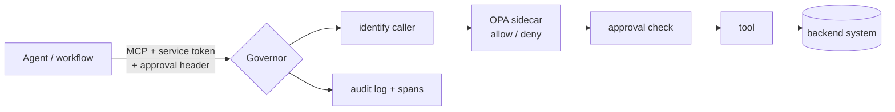

# aurai-mcp-connectors

The tool layer of the Aurai platform: MCP servers that let agents reach work management, operations data, messaging and files, with a policy decision, an approval where one is required, and an audit record on **every** call.

> **Synthetic project.** Aurai is a fictional enterprise AI platform for the fictional company "Amazing-Enterprise". Every ticket, file, person and number here is invented, and the systems behind the connectors are in-memory stand-ins. This is a working prototype with production patterns, not a production system; the gaps are listed below.

## What it does

- **One governed path for every tool.** A tool is registered only through the `Governor`. Each call identifies the caller from a verified service token, classifies the data involved, asks policy, checks approval, runs, and writes an audit line and spans. Tool code contains none of that.
- **Policy as reviewed data.** Open Policy Agent (Rego) runs as a sidecar in each connector pod. Default deny; per-team scopes and data limits live in `policy/teams.yaml`; 17 Rego tests run in CI.
- **Approvals that cannot be reused or redirected.** A write that needs a human approval runs only with a signed, single-use token bound to that tool, those exact arguments and that caller. The agent cannot approve itself.
- **A review gate for new connectors.** Every connector needs a current, approved security review covering exactly its tools, or CI fails.
- **Four connectors:** `tickets`, `ops-data` (read-only), `messaging` (sending always needs approval) and `files` (labelled per file).



## Requirements covered

From the Aurai PRD, Tools and connectors area. The PRD's open question, which connectors first, is answered with these four: work management and operations data cover the existing `ops-insights` use case, and messaging and files exercise the two hardest controls (irreversible actions and per-item sensitivity).

| ID | Requirement | Where |
|---|---|---|
| MC-1 | Standard connector pattern using MCP | `framework.py`, manifests in `connectors/`; [docs/connector-authoring.md](docs/connector-authoring.md) |
| MC-2 | Policy check (allow/deny) on every tool call | `policy/aurai/tools.rego`, `policy.py`; [docs/policy.md](docs/policy.md) |
| MC-3 | Per-team scoping of connector access | `policy/teams.yaml` |
| MC-4 | Security review workflow for new connectors | `connectors/*/review.yaml`, `reviews.py`, `aurai-connectors check` |

Also: write actions follow the risk tiers (T2 one approval, T3 two), and spans use the `aurai.tool.call` and `aurai.approval` conventions from `aurai-eval-governance`.

## Try it without a cluster

```powershell
pip install -e ".[dev]"
ruff check .
pytest -q
aurai-connectors check
opa test policy
```

The policy tests need the `opa` binary ([install](https://www.openpolicyagent.org/docs/#running-opa)); without it they are skipped. To call a connector from an MCP client over stdio, run `scripts\run-local.ps1`. To deploy on the local kind cluster, see [docs/local-development.md](docs/local-development.md).

## Repository layout

| Path | Contents |
|---|---|
| `src/aurai_connectors/` | `framework.py` (the governed path), `identity.py`, `policy.py`, `approvals.py`, `audit.py`, `tracing.py`, `manifest.py`, `reviews.py`, `connectors/`, `backends.py`, `cli.py` |
| `connectors/<name>/` | `connector.yaml` (tools, actions, classification, approval) and `review.yaml` (security review) |
| `policy/` | `aurai/tools.rego`, `aurai/tools_test.rego`, `teams.yaml` |
| `charts/aurai-connectors/` | One Deployment and Service per connector with an OPA sidecar, policy ConfigMap, NetworkPolicy, values for local and AWS |
| `scripts/` | Local deploy, stdio run, port-forward, undeploy |
| `docs/` | Architecture, policy, approvals, identity, connector authoring, local development, runbook |

## Honest status

**Verified here**
- 135 tests pass (ruff clean), including: every connector's tools end to end over its real ASGI app with real JSON-RPC requests; the full approval matrix (wrong tool, arguments, team, use case, self-approval, too few approvers, expired, over-long, tampered, unsigned, replayed); fail-closed behaviour when policy is down, slow, malformed or crashing; that no argument or result text reaches the audit log or spans; that a caller-supplied tier or team header changes nothing.
- The Rego rules run under a real `opa` binary: 17 unit tests, and the connector's HTTP client against a real `opa run --server` over a flat policy folder, as the chart mounts it.
- `aurai-connectors serve` starts under uvicorn, answers `/healthz` and returns 401 without a token. The chart's template syntax parses.

**Not verified**
- `helm lint`, `helm template`, kubeconform and the container build were not run here; CI runs them. Whether OPA loads the policy cleanly from a ConfigMap mount (Kubernetes adds symlinked directories) and whether the pinned OPA image tag exists are unchecked.
- Nothing has run against a real Keycloak. Tokens in tests are signed with locally generated keys. The service clients and their `team_id`/`use_case_id` claim mappers do not exist yet ([docs/identity.md](docs/identity.md)).
- The stdio transport is exercised through an in-memory MCP client, not a real subprocess pipe. No agent or MCP client product has called these servers.
- `RedisUsedTokens` is tested against a fake client only.
- The connectors' backends are synthetic in-memory data. Nothing here proves behaviour against a real work-management, warehouse, mail or document system.

**What production would add**
- The approval service: the UI and notifications that show approvers the exact call, rules for who may approve what, and asymmetric signing so connectors hold only a public key, with key rotation.
- Real backends with least-privilege credentials per connector, secrets from a manager, and egress rules (the NetworkPolicy here restricts ingress only).
- OPA bundles served and versioned from a registry instead of a ConfigMap, with decision-log shipping and an alert on `policy_unavailable`.
- Rate limits and quotas per team and tool, result-size caps, and prompt-injection defences for content returned to the model (output is data, but a ticket body can still carry instructions).
- Audit log shipping to tamper-evident storage with retention set by classification, and dashboards on denials, approval latency and refusals.
- Shared single-use storage that survives Redis failover, and a dual-control rule for changes to `policy/teams.yaml` enforced in the repository settings.

## License

MIT. See [LICENSE](LICENSE).
